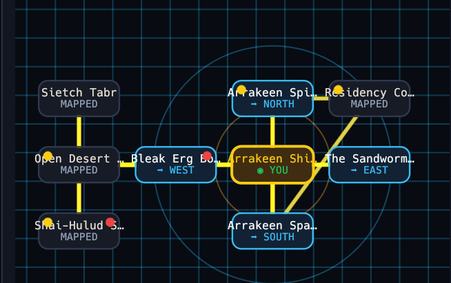

*This project has been created as part of the 42 curriculum by jaatif-a, dzhambal.*

# TAP — The Answer Protocol (Arrakis Edition)

A real-time multiplayer Multi-User Dungeon (MUD) engine, asynchronous CLI client, and graphical tactical terminal built in **Rust**, implementing **RFC 42TAP** over line-framed TCP sockets and set in the desert world of **Arrakis (Dune)**.

---

## Description

**The Answer Protocol (TAP)** is a shared-world, real-time multiplayer text adventure inspired by classic university MUDs. Multiple players connect concurrently over TCP to explore an interconnected map of Arrakis, scavenge unique equipment, converse with Fremen and Atreides characters, form squads, accept contracts, and engage in turn-based combat against Harkonnen raiders and sandworms.

The repository is structured as a **4-crate Rust Cargo Workspace** to enforce strict separation of concerns between wire parsing, authoritative server state, and user interfaces:

* **`protocol`**: Pure, zero-I/O implementation of the **RFC 42TAP** wire specification (case-insensitive ABNF command parser, reply/event serializers, structured JSON payloads, fuzzy item/NPC reference matching, and canonical error definitions).
* **`server`**: Asynchronous multi-client TCP server powered by `tokio`, featuring startup YAML world validation, unique instance item tracking, turn-based combat, quest progression, squad management, bounded line framing, anti-flooding protection, and structured JSON logging.
* **`cli`**: Non-blocking terminal client using `tokio::select!` to render real-time asynchronous server events (`EVT ...`) while awaiting keyboard input.
* **`gui`**: Native graphical client built with `eframe`/`egui` featuring a dark Modern-MUD aesthetic, procedural vector character portraits, an interactive fog-of-war cartographic radar with travel trails, separated chat channels (`Global`, `Room`, `Group`), and a color-coded telemetry/combat log.

---

## Instructions

### Prerequisites
* **Rust Toolchain** (`rustc` and `cargo`, edition 2021+, with `clippy` and `rustfmt` components)
* **GNU Make**
* *(Linux GUI)* Standard X11/Wayland and OpenGL development libraries required by `eframe`/`winit` (pre-installed on 42 Ubuntu workstations).

### Quick Start
1. **Install toolchain components, fetch crates, and compile the workspace:**
   ```bash
   make install
   ```
2. **Start the authoritative game server (defaults to `127.0.0.1:4242`; override `PORT` if needed):**
   ```bash
   make run-server PORT=4243
   ```
3. **Launch the Graphical Client (in a second terminal):**
   ```bash
   make run-client-gui PORT=4243
   ```
4. **Or launch the CLI Client (in another terminal for multiplayer testing):**
   ```bash
   make run-client PORT=4243
   ```

---

## Architecture

### Workspace Layout
```text
The_Answer_protocol/
├── Cargo.toml                  # Shared workspace dependencies & resolver
├── Makefile                    # Mandatory build, run, lint, test, and clean targets
├── data/
│   └── world.yaml              # Arrakis map, items, NPCs, and quest definitions
├── crates/
│   ├── protocol/
│   │   └── src/lib.rs          # RFC 42TAP parser, serializer, JSON payloads & unit tests
│   ├── server/
│   │   └── src/
│   │       ├── main.rs         # TCP listener, bounded reader, writer tasks & JSON logger
│   │       ├── state.rs        # Authoritative GameState, combat, quests, squads & rate-limiter
│   │       └── world.rs        # YAML loader & startup referential integrity validator
│   ├── cli/
│   │   └── src/main.rs         # Non-blocking async terminal client (tokio::select!)
│   └── gui/
│       └── src/
│           ├── main.rs         # GUI application state & network event dispatcher
│           ├── net.rs          # Background Tokio TCP worker bridged via mpsc channels
│           ├── ui.rs           # Multi-panel HUD, inventory, quests, entity cards & comms
│           ├── radar.rs        # Interactive fog-of-war cartographic map & movement trail
│           ├── avatars.rs      # Procedural vector portraits by entity archetype
│           └── theme.rs        # Arrakis dark palette & custom RPG widgets
└── README.md
```

### Server Concurrency & Routing Model
* **Hybrid Task-per-Connection + Centralized Authoritative State (`Arc<RwLock<GameState>>`):**
  * Each accepted `TcpStream` is split into independent read and write halves via `stream.into_split()`.
  * A dedicated **outbound writer task** consumes messages from a per-client `tokio::sync::mpsc::unbounded_channel<ServerMessage>` and writes them to the socket. This decouples slow or abruptly disconnected clients from global and room broadcasts: `broadcast_to_room` simply pushes clones into each recipient's `mpsc` channel without holding the `RwLock` across network `.await` points.
  * Inbound streams are read through a bounded line reader (`MAX_LINE_LENGTH = 1024` bytes), properly handling TCP packet fragmentation and coalescing across `\n` / `\r\n` boundaries while preventing memory exhaustion from unterminated streams.
* **Command Dispatching:**
  * Parsed `protocol::Command` variants are routed through an explicit match-based dispatcher in `GameState::handle_command`.
  * Unauthenticated sockets are strictly gated: only `CONNECT <username>` and `QUIT` are accepted prior to login; any other command returns `ERR 403 NOT_AUTHENTICATED`.
* **Graceful Disconnect Ordering:**
  * When a client sends `QUIT`, closes the socket (`EOF`), or hits a network error, `GameState::disconnect_player` removes the player from `players`, clears active combat references, and removes them from any `GroupState` **before** broadcasting `EVT ROOM PRESENCE LEAVE <username>` and `EVT STATS players=<count>`. This guarantees zero ghost players in subsequent `LOOK` or `WHO` queries.

### Client Responsiveness Model
* **CLI Client (`crates/cli`):** Uses `tokio::select!` to multiplex `tokio::io::stdin()` and the TCP `BufReader` concurrently on a single async runtime, printing incoming `EVT` lines immediately without blocking user keyboard input.
* **GUI Client (`crates/gui`):** Runs `eframe` on the main OS UI thread while a dedicated background OS thread hosts a Tokio current-thread runtime (`crates/gui/src/net.rs`). Bidirectional `std::sync::mpsc` channels combined with `egui::Context::request_repaint()` ensure instant UI updates whenever server replies or asynchronous events arrive.

---

## Protocol Implementation

The implementation strictly adheres to **RFC 42TAP** (`OK hello proto=1` greeting, UTF-8 encoding, `\n` line termination, case-insensitive command verbs, canonical error codes `201`, `301`, `401`, `402`, `404`, `405`, `406`, `900`, `901`, structured JSON replies, and standard `EVT` notifications), ensuring interoperability with third-party RFC 42TAP clients and servers.

### Documented Extensions & Justifications
Because RFC 42TAP Section 6.1 intentionally leaves combat mechanics, quest progression, and certain edge-case errors open to team design, we introduced the following backwards-compatible extensions:

| Extension | Wire Format | Justification |
| :--- | :--- | :--- |
| **Combat Stance Command** | `DEFEND` | Provides a tactical defensive turn option in turn-based combat ($+5\text{ HP}$ recovery and $50\%$ incoming damage reduction on the next counterattack). |
| **Combat Disengage Command** | `FLEE` | Allows players to cleanly disengage from an active combat state (`in_combat_with = None`) without disconnecting. |
| **Room Item Events** | `EVT ROOM ITEM TAKE <user> <item-id>`<br>`EVT ROOM ITEM DROP <user> <item-id>` | Enables co-located clients (especially the GUI) to refresh room loot automatically when another player picks up or drops an item. |
| **Combat Broadcast Events** | `EVT COMBAT START\|HIT\|DEFEND\|FLEE\|DEFEAT\|RESPAWN ...` | Provides real-time multiplayer visibility of fights and respawns occurring in the same room (RFC Section 5 / Chapter V.1). |
| **Quest Progress Events** | `EVT QUEST ACCEPTED\|PROGRESS\|COMPLETE ...` | Notifies the player asynchronously when an objective advances or finishes after a `TAKE` or combat victory. |
| **Extended Error Codes** | `400 BAD_REQUEST`, `403 NOT_AUTHENTICATED`, `409 ALREADY_CONNECTED`, `410 NOT_IN_COMBAT`, `413 LINE_TOO_LONG`, `429 RATE_LIMITED`, `500 INTERNAL_ERROR` | Distinguishes malformed syntax, pre-login commands, duplicate `CONNECT`, out-of-combat `DEFEND`/`FLEE`, oversized frames ($> 1024\text{ bytes}$), and anti-flooding throttling from standard `404` errors. |

---

## Combat System

Combat is **turn-based** and initiated whenever a player executes `ATTACK <npc>` against an NPC with `role: enemy` in the same room:

1. **Player Stats & Damage Formula:**
   * Players spawn with $100 / 100\text{ HP}$ and a base attack power of $10$.
   * Carrying weapons or combat gear in the inventory adds passive attack bonuses (`item.crysknife`: $+8$, `item.maker_hooks`: $+5$, `item.fremen_stillsuit`: $+4$, `item.thumper`: $+2$).
   * $$\text{Player Damage} = 10 + \sum_{i \in \text{Inventory}} \text{attack\_bonus}(i)$$
2. **Initiative & Turn Resolution:**
   * **Player acts first** on `ATTACK <npc>`, dealing $\text{Player Damage}$ immediately to the NPC's current HP.
   * **Enemy Victory:** If the NPC reaches $0\text{ HP}$, combat ends (`status: "victory"`), `EVT COMBAT DEFEAT` is broadcast to the room, defeat-based quests are evaluated, and the NPC's HP resets in the shared world so other players can also complete contracts.
   * **Enemy Counterattack:** If the NPC survives ($\text{target\_hp} > 0$), it immediately counterattacks in the same turn for its configured `damage` (`Harkonnen Scout`: $10$, `Shai-Hulud`: $18$).
3. **Tactical Commands (`DEFEND` & `FLEE`):**
   * `DEFEND`: Restores $+5\text{ HP}$ (capped at $100$) and activates a defensive guard flag that halves the next incoming counterattack:
     $$\text{Mitigated Damage} = \max\left(1, \left\lfloor \frac{\text{Enemy Damage}}{2} \right\rfloor\right)$$
   * `FLEE`: Clears active combat status (`status` returns to `"healthy"` or `"wounded"`).
4. **Death & Respawn ($0\text{ HP}$):**
   * If a counterattack reduces a player to $0\text{ HP}$, they automatically respawn at the Fremen sanctuary (`loc.sietch_tabr`) with **$50\text{ HP}$**, and `EVT COMBAT RESPAWN` plus room presence events are broadcast.

---

## Quest System

Quests are defined declaratively in `data/world.yaml` and tracked per-player in `PlayerSession::quests`:

* **Discovery & Acceptance (`QUEST <npc>`):**
  * Executing `QUEST <npc>` on a `quest_giver` NPC in the current room registers the quest as `active` (`progress: 0`) and returns the RFC JSON offer payload (`quest_id`, `description`, `reward`, `status: "available"`).
  * Requesting an already active or completed quest returns `ERR 406 NO_QUEST_AVAILABLE`.
* **Objective Types & Automatic Validation:**
  * **`collect_item` (`quest.spice_harvest`):** Validated immediately upon accepting the quest and after every `TAKE` command by counting matching `target` items (`item.raw_melange`) in the player's inventory.
  * **`defeat_npc` (`quest.harkonnen_raid`):** Validated automatically when a player deals the finishing blow to the target NPC (`npc.harkonnen_scout`).
* **Reward Distribution & Tracking (`QUESTS`):**
  * Upon reaching `required_count`, the quest transitions to `completed`, the `reward_item` (`item.guild_solari` or `item.fremen_stillsuit`) is automatically added to the player's inventory (with duplicate prevention for unique items), and `EVT QUEST COMPLETE <quest-id> <reward>` is pushed to the client.
  * `QUESTS` returns a JSON array of all active (with `"progress": "x/y"`) and completed contracts.

---

## World Design

The game world (`data/world.yaml`) is modeled after **Arrakis (Dune)** and validated at server startup (`WorldData::validate`) to guarantee referential integrity across all exits, items, NPCs, and quests.

### Topology (9 Interconnected Rooms)
The map features a **4-room central circuit loop** inside Arrakeen plus **two optional exploration branches** (the Cantina and the Deep Desert / Sietch Tabr / Sandworm Pit):



```text
                       [loc.market] ◄───────► [loc.palace_courtyard]
                     Arrakeen Spice Market       Residency Courtyard
                            ▲                            ▲
                            │                            │
                            ▼                            ▼
[loc.sietch_tabr]     [loc.arrakeen_gate] ◄───► [loc.spaceport]
   Sietch Tabr ◄──┐    Arrakeen Gate (SPAWN)     Arrakeen Spaceport
                  │         ▲         │
                  │         │         ▼
                  │         │   [loc.cantina]
                  │         ▼   Sandworm Cantina
                  │  [loc.desert_edge]
                  │  Bleak Erg Border
                  │         ▲
                  │         │
                  │         ▼
                  └─► [loc.spice_blow] ◄───► [loc.worm_cavern]
                     Open Spice Blow         Shai-Hulud Sand Pit
```

| Room ID | Display Name | Connected Exits | Initial Items | NPCs Present |
| :--- | :--- | :--- | :--- | :--- |
| `loc.arrakeen_gate` | Arrakeen Shield Wall Gate *(Spawn)* | `north` $\rightarrow$ `loc.market`<br>`east` $\rightarrow$ `loc.spaceport`<br>`south` $\rightarrow$ `loc.desert_edge` | `item.crysknife`<br>`item.water_flask` | `npc.atreides_guard` |
| `loc.market` | Arrakeen Spice Market | `south` $\rightarrow$ `loc.arrakeen_gate`<br>`east` $\rightarrow$ `loc.palace_courtyard` | `item.spice_coffee` | `npc.spice_merchant` |
| `loc.palace_courtyard` | Arrakeen Residency Courtyard | `west` $\rightarrow$ `loc.market`<br>`south` $\rightarrow$ `loc.spaceport` | `item.ducal_signet` | `npc.mentat` |
| `loc.spaceport` | Arrakeen Landing Field | `west` $\rightarrow$ `loc.arrakeen_gate`<br>`north` $\rightarrow$ `loc.palace_courtyard`<br>`south` $\rightarrow$ `loc.cantina` | `item.thumper` | — |
| `loc.cantina` | Sandworm Cantina | `north` $\rightarrow$ `loc.spaceport` | `item.baliset` | `npc.smuggler` |
| `loc.desert_edge` | Bleak Erg Border | `north` $\rightarrow$ `loc.arrakeen_gate`<br>`west` $\rightarrow$ `loc.spice_blow` | — | `npc.harkonnen_scout` |
| `loc.spice_blow` | Open Spice Blow | `east` $\rightarrow$ `loc.desert_edge`<br>`north` $\rightarrow$ `loc.sietch_tabr`<br>`south` $\rightarrow$ `loc.worm_cavern` | `item.raw_melange` | — |
| `loc.sietch_tabr` | Sietch Tabr | `south` $\rightarrow$ `loc.spice_blow` | `item.maker_hooks`<br>`item.water_of_life` | `npc.stilgar` |
| `loc.worm_cavern` | Shai-Hulud Sand Pit | `north` $\rightarrow$ `loc.spice_blow` | — | `npc.sandworm` |

### NPCs & Roles (7 NPCs across 3 Distinct Roles)
| ID | Name | Role | Location | HP / DMG | Function |
| :--- | :--- | :--- | :--- | :--- | :--- |
| `npc.atreides_guard` | Atreides Trooper | `dialogue` | `loc.arrakeen_gate` | 60 / 0 | Lore & desert warnings |
| `npc.smuggler` | Gurney Smuggler | `dialogue` | `loc.cantina` | 50 / 0 | Spice trade rumors |
| `npc.mentat` | Thufir Mentat | `dialogue` | `loc.palace_courtyard` | 45 / 0 | Strategic advice |
| `npc.spice_merchant` | Chani Spice Trader | `quest_giver` | `loc.market` | 50 / 0 | Assigns `quest.spice_harvest` |
| `npc.stilgar` | Stilgar | `quest_giver` | `loc.sietch_tabr` | 90 / 0 | Assigns `quest.harkonnen_raid` |
| `npc.harkonnen_scout` | Harkonnen Scout | `enemy` | `loc.desert_edge` | 35 / 10 | Hostile raider |
| `npc.sandworm` | Shai-Hulud | `enemy` | `loc.worm_cavern` | 80 / 18 | Apex boss creature |

### Dynamic Items (Multi-Word & Unique Instances)
Items exist as unique instances in `GameState::room_items`: `TAKE` removes an item from the room (preventing duplication across players), and `DROP` places it in the player's current room. Both canonical IDs (`item.crysknife`) and multi-word display names (`"Crysknife"`, `"Raw Melange"`, `"Litrejon Water Flask"`) are supported via `protocol::matches_reference`. `item.water_of_life` in `loc.sietch_tabr` is marked `obtainable: false` as a scenic landmark object and returns `ERR 405 ITEM_NOT_OBTAINABLE` if a player attempts to pick it up.

---

## Server Logging

The server uses **`tracing`** and **`tracing-subscriber`** (with the `json` and `time` features) to emit structured, machine-parseable JSON logs to standard output without blocking async Tokio worker threads.

* **Log Format & Fields:**
  * Every log line is a self-contained JSON object containing an ISO-8601 UTC `timestamp`, `level` (`INFO`, `WARN`, `ERROR`), `target`, and structured `fields` (`event`, `username`, `addr`, `room_id`, `cmd`, `code`, etc.).
* **Event Levels:**
  * **`INFO`**: Startup world validation stats (`world_loaded`), TCP connections (`tcp_connected` with client `SocketAddr`), player logins/logouts (`player_connected`, `player_disconnected`), incoming commands (`command_received`), outbound replies (`reply_sent`), movement (`player_moved`), item transfers (`item_taken`, `item_dropped`), combat rounds (`combat_attack`, `combat_defend`, `combat_flee`, `combat_respawn`), and quest milestones (`quest_accepted`, `quest_completed`).
  * **`WARN`**: Malformed commands (`malformed_command`), rejected logins (`auth_failed`), non-existent exits/items/NPCs, oversized frames (`line_too_long`), socket read errors, and abuse alerts.
  * **`ERROR`**: Critical task panics or startup configuration/validation failures.
* **Abuse & Flooding Detection:**
  * **Command Rate Limiter:** Each `PlayerSession` tracks command counts within a 2-second sliding window (`check_rate_limit`). Exceeding **20 commands in 2 seconds** triggers a `WARN` log (`event: "abuse_flooding"` with username, IP address, and command rate) and rejects the burst with `ERR 429 RATE_LIMITED`.
  * **Frame Size Guard:** Inbound lines exceeding `MAX_LINE_LENGTH` ($1024\text{ bytes}$) are drained safely without allocating unbounded memory, rejected with `ERR 413 LINE_TOO_LONG`, and logged as `WARN`.
  * **Connection Burst Monitoring:** Rapid repeated TCP connection attempts from the same IP address are tracked and logged as `WARN` (`event: "abuse_rapid_connections"`) for operator inspection.

---

## Group Contributions

* **`jaatif-a`**:
  * Designed and implemented the shared `crates/protocol` crate (RFC 42TAP ABNF command parser, reply/event serializer, JSON payload structs, `matches_reference` resolver, and 16 unit tests).
  * Architected and built the asynchronous TCP server (`crates/server`: YAML world loader/validator, `GameState`, turn-based combat engine, quest progression system, squad management, rate-limiting, and structured JSON logging).
  * Built the non-blocking asynchronous CLI terminal client (`crates/cli` using `tokio::select!`).
  * Authored the Arrakis/Dune world dataset (`data/world.yaml`), `Makefile` automation, and technical documentation (`README.md`).
* **`dzhambal`**:
  * Designed and implemented the native graphical client (`crates/gui` built with `eframe`/`egui`), including the Modern-MUD visual theme (`theme.rs`), background Tokio network worker bridged via `mpsc` channels (`net.rs`), multi-panel tactical HUD and comms layout (`ui.rs`), interactive fog-of-war cartographic radar with travel trails (`radar.rs`), and procedural vector character portraits (`avatars.rs`).
  * Conducted end-to-end GUI usability, multi-client synchronization, and interoperability testing.

---

## Building and Running

All lifecycle commands are automated through the root `Makefile` (with configurable `HOST`, `PORT`, and `WORLD_FILE` variables):

| Target | Command | Description |
| :--- | :--- | :--- |
| `make install` | `rustup component add clippy rustfmt && cargo fetch && cargo build --workspace` | Installs toolchain linters, fetches crates, and compiles all 4 crates. |
| `make build` | `cargo build --workspace` | Compiles `protocol`, `server`, `cli`, and `gui`. |
| `make run-server` | `cargo run -p server -- --host $(HOST) --port $(PORT) --world $(WORLD_FILE)` | Starts the TCP game server (e.g., `make run-server PORT=4243`). |
| `make run-client` | `cargo run -p cli -- --host $(HOST) --port $(PORT)` | Starts the interactive CLI client. |
| `make run-client-gui` | `cargo run -p gui -- --host $(HOST) --port $(PORT)` | Starts the `egui` graphical client. |
| `make lint` | `cargo fmt --all -- --check && cargo clippy --workspace --all-targets -- -D warnings` | Enforces `rustfmt` formatting and zero-warning strict Clippy checks. |
| `make test` | `cargo test --workspace` | Executes all protocol and world validation unit tests. |
| `make clean` | `cargo clean` | Removes build artifacts. |

### Raw TCP Verification (`netcat`)
Because RFC 42TAP uses line-framed UTF-8 over TCP, you can also inspect raw wire traffic directly:
```bash
nc 127.0.0.1 4243
```

---

## Testing

### 1. Automated Unit & Validation Tests
Run the full test suite and strict linter:
```bash
make test
make lint
```
* **`protocol` tests (16 tests):** Verify round-trip parsing and formatting for all commands and `EVT` notifications, case-insensitivity, CRLF/LF handling, multi-word item references, Unicode usernames, oversized frame rejection, and exact RFC error codes.
* **`server` tests:** Validate `data/world.yaml` room counts, NPC roles, obtainable items, quest definitions, and cross-reference integrity.

### 2. Multiplayer & Interoperability Testing
1. **Start the server:** `make run-server PORT=4243`
2. **Open two or more clients simultaneously:** Launch `make run-client-gui PORT=4243` as `Paul` and `make run-client PORT=4243` as `Chani` (or connect a third-party RFC 42TAP client).
3. **Presence & Chat:** Move between rooms (`MOVE north`) and send `CHAT GLOBAL`, `CHAT ROOM`, and `CHAT GROUP` messages to verify real-time `EVT` delivery across clients.
4. **Item Uniqueness & Non-Obtainable Objects:**
   * Have Player A run `TAKE Crysknife` while Player B is in `loc.arrakeen_gate`; confirm Player B receives `EVT ROOM ITEM TAKE` and cannot duplicate the item (`ERR 404 ITEM_NOT_FOUND`) until Player A runs `DROP Crysknife`.
   * In `loc.sietch_tabr`, attempt `TAKE item.water_of_life` and verify the server rejects it with `ERR 405 ITEM_NOT_OBTAINABLE`.
5. **Combat & Quest Flow:**
   * Travel `north` to `loc.market`, run `QUEST npc.spice_merchant`, travel `south` $\rightarrow$ `west` $\rightarrow$ `west` to `loc.spice_blow`, and run `TAKE Raw Melange` to verify automatic quest completion and `item.guild_solari` reward delivery.
   * Engage `npc.harkonnen_scout` (`ATTACK npc.harkonnen_scout`, `DEFEND`, `FLEE`) and `npc.sandworm` (`ATTACK npc.sandworm`) to verify damage formulas, counterattacks, and $0\text{ HP}$ respawn at `loc.sietch_tabr`.
6. **Abrupt Disconnects & Flood Protection:**
   * Kill a client with `Ctrl+C` or `kill -9` and verify the server logs `player_disconnected` in JSON and immediately broadcasts `EVT ROOM PRESENCE LEAVE` without interrupting remaining sessions.
   * Send $> 20$ commands within $2\text{ seconds}$ to confirm `ERR 429 RATE_LIMITED` and the `abuse_flooding` JSON warning log.

---

## Resources

### Technical References
* **RFC 42TAP Specification** (`docs/rfc42tap.html`) — *The Answer Protocol: A TCP-Based Multi-User Dungeon Communication Protocol*, 42 School Network Working Group.
* **RFC 2119 & RFC 5234** — *Key words for use in RFCs* and *Augmented BNF for Syntax Specifications (ABNF)*.
* **The Rust Programming Language & Cargo Book** — https://doc.rust-lang.org/book/
* **Tokio Asynchronous Runtime Documentation** — https://tokio.rs/tokio/tutorial
* **`eframe` / `egui` Immediate Mode GUI Documentation** — https://docs.rs/eframe/
* **`tracing` & `tracing-subscriber` Structured Logging** — https://docs.rs/tracing/

### AI Usage Disclosure
In accordance with Chapter I and Chapter VI guidelines, AI assistance (Gemini) was used selectively as a collaborative engineering aid under full human review and verification:
* **Scaffolding & Boilerplate:** Generating initial `Cargo.toml` workspace manifests, `Makefile` targets, and unit test templates for RFC 42TAP command/event round-trips.
* **GUI Layout & Vector Drawing:** Assisting with `egui` layout structuring, procedural vector portrait coordinates (`avatars.rs`), and cartographic radar grid math (`radar.rs`).
* **Documentation:** Structuring and formatting the `README.md` to ensure all mandatory 42 evaluation sections were clearly addressed.
* **Human Verification:** All protocol parsers, server state locking, combat/quest logic, YAML world design, and client networking loops were reviewed, compiled under `cargo clippy -- -D warnings`, and tested interactively across multiple concurrent sessions.